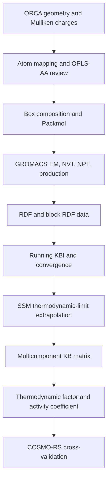

# SolvForge MD

**Local-first molecular simulation planning and Kirkwood–Buff analysis for reproducible solvent research.**

[](LICENSE)
[](package.json)

SolvForge MD is research software for designing GROMACS molecular-dynamics studies, preparing molecular systems from ORCA outputs, and analysing Kirkwood–Buff integrals (KBI). It was developed around a deep eutectic solvent (DES) thesis workflow, but every molecule, composition, state point, simulation parameter, and analysis setting remains editable.

The application is deliberately conservative: missing evidence produces a diagnostic instead of a fabricated result. It does not execute ORCA, Packmol, or GROMACS in the browser.

## Scientific workflow



The built-in **Andaliman Thesis MD/KBI** preset preserves the intended hierarchy:

1. Stage A: four DES candidates × three solutes at 323.15 K.
2. Researcher explicitly selects a champion DES.
3. Stage B: champion DES × seven editable solute loadings at 323.15 K.
4. Researcher explicitly selects an optimum concentration.
5. Stage C: champion DES and selected concentration × five editable temperatures.

SolvForge MD never silently converts this workflow into a full temperature × concentration factorial design. Arbitrary factorial matrices remain available in Custom Mode.

## Core capabilities

### Experimental design and GROMACS planning

- Editable molecule registry, DES definitions, ratios, temperatures, pressures, boxes, replicas, and protocols.
- Deterministic run IDs backed by complete manifests.
- Stage A, B, C, and arbitrary custom matrices.
- Editable EM, NVT, NPT, and production `.mdp` generation.
- `.mdp` diagnostics for malformed or conflicting directives.
- Reproducible run directories, shell commands, JSON/CSV manifests, and ZIP export.

### Physical box composition

- Manual molecule-count mode.
- Density-based integer composition from box volume, molecular weights, molar ratio, and optional solute mass.
- Alternative nearby integer candidates with density deviations.
- Explicit solute-mass policy and optional locked DES counts across a concentration series.
- Mole fractions, mass fractions, number densities, and temperature-aware density provenance.
- No absolute count is ever generated from a molar ratio alone.

### ORCA → GROMACS preparation

- Import and preserve paired ORCA `.xyz` and `.out` files.
- Parse final coordinates, atom order, method/basis metadata, formal charge, and raw Mulliken atomic charges.
- Validate atom count, element sequence, geometry, charge count, and total charge.
- Explicit atom mapping when `.xyz` and `.out` orders differ.
- Deterministic, editable atom and residue names with exported `atom_mapping.csv`.
- Coordinate conversion from Å to GROMACS-compatible nm without silent reordering.
- Reviewable covalent-radius connectivity suggestions.
- Import and review OPLS-AA/`x2top` topology information.
- Controlled merge of OPLS-AA mechanical parameters with the thesis Mulliken charges.
- Molecular `.itp`, PDB, GRO, Packmol, `topol.top`, index, RDF, block-RDF, and SSM file generation.
- Interactive English tutorial explaining inputs, outputs, commands, checks, and common failures for every MD stage.

The thesis preset intentionally uses **OPLS-AA with raw Mulliken-derived charges from ORCA BP86/def2-TZVP**. SolvForge MD does not silently normalise those charges or substitute another charge model.

ORCA outputs are not a complete force field. Missing atom types, Lennard–Jones parameters, bonded parameters, exclusions, or unresolved atom mapping keep the topology marked **INCOMPLETE — NOT READY FOR PRODUCTION MD**.

### RDF, KBI, and convergence

- Actual GROMACS `.xvg` and CSV parsing with explicit unit selection.
- Raw, rebinned, and reversibly smoothed RDF series.
- Trapezoidal and supported composite-Simpson running KBI integration:

  $$G_{ij}(R)=4\pi\int_0^R [g_{ij}(r)-1]r^2\,dr$$

- Manual plateau selection and configurable candidate-plateau diagnostics.
- Replica means, SD, SEM, confidence intervals, and disagreement flags without automatic outlier deletion.
- Time-block and accumulated-time convergence analysis with researcher-controlled acceptance.

### Finite-size and thermodynamic analysis

- SSM command generation and regression using

  $$G_{ij}^{V}(L)=G_{ij}^{\infty}+\frac{F_{ij}^{\infty}}{L}$$

- Regression uncertainty, confidence intervals, residuals, leverage, and goodness-of-fit.
- Complete symmetric multicomponent KB matrix with missing/unconverged/finite-size-corrected states.
- Ternary solute + two-component DES thermodynamic-factor calculation without silently treating the DES as a pseudocomponent.
- Matrix determinant, inverse, conditioning diagnostics, and Monte Carlo uncertainty propagation.
- Discrete-composition activity-coefficient integration and controlled infinite-dilution extrapolation.
- openCOSMO-RSpy CSV mapping, compatible-quantity checks, correlation/error statistics, residuals, and ranking comparison.

### Reproducibility

- Local browser persistence with project JSON import/export.
- Raw imported numerical data retained separately from processed results.
- Full provenance for molecular composition, simulation settings, RDF processing, KBI plateaus, convergence, SSM, matrix calculations, uncertainty, and researcher overrides.
- Complete project ZIP and printable/machine-readable analysis reports.
- Internal numerical validation tests with explicit PASS/FAIL results.

## Getting started

### Use the application

1. Open SolvForge MD and choose **Andaliman Thesis MD/KBI** or Custom Mode.
2. Review the molecule registry and enter density information or manual molecule counts.
3. Generate the required Stage A runs.
4. Open **ORCA → GROMACS**, enable Tutorial Mode, and import one `.xyz` plus one `.out` per molecular species.
5. Resolve atom mapping, connectivity, OPLS-AA types, and topology diagnostics.
6. Generate Packmol and GROMACS project files.
7. Run Packmol and GROMACS externally, following the generated tutorial/checklist.
8. Import the resulting RDF `.xvg` files into the KBI Analyzer.
9. Validate plateaus, replicas, time convergence, finite-size behaviour, and the KB matrix before thermodynamic calculations.
10. Export the complete project regularly. Browser storage is convenient, but the exported project is the portable research record.

### Run locally

Requirements:

- Node.js 22.13 or newer
- npm

```bash
git clone https://github.com/iehoshva/solvforge-md.git
cd solvforge-md
npm install
npm run dev
```

Open the local address printed by the development server.

Useful commands:

```bash
npm run lint     # static checks
npm test         # production build and numerical/UI tests
npm run build    # production build only
```

ORCA, Packmol, and GROMACS are external scientific programs and must be installed separately when executing the exported workflow.

## Repository structure

```text
app/                         Application entry point and global styling
components/workbench/        Scientific views and interactive workflow
lib/workbench/               Numerical methods, parsers, generators, and models
tests/                       Deterministic scientific and rendering tests
scripts/                     Build and environment helpers
```

Scientific numerical code is kept separate from the UI so that individual methods can be audited or replaced by a future NumPy/SciPy backend.

## Scientific responsibility

Generated inputs are research artifacts, not a guarantee that a chosen force field, charge model, density, box size, equilibration duration, cutoff, finite-size model, or plateau is appropriate for a particular system. Always inspect GROMACS warnings and energies, validate density and equilibration, test convergence and finite-size effects, and document every manual override.

No generated topology should be used for production MD while SolvForge MD reports unresolved atom mapping, missing parameters, coordinate/topology count disagreement, or a failed external `gmx grompp` validation.

## Contributing

Issues and pull requests are welcome. Changes to scientific algorithms should include:

- the implemented equation and assumptions;
- units and numerical method;
- deterministic validation data or an analytic reference;
- tests covering valid inputs and insufficient-data behaviour;
- matching updates to the in-app **Method / Equations** documentation.

## License

SolvForge MD is free software licensed under the **GNU General Public License v3.0**. See [LICENSE](LICENSE).

Copyright © 2026 Yehosyua Widiatmo Wyldanta and contributors.
